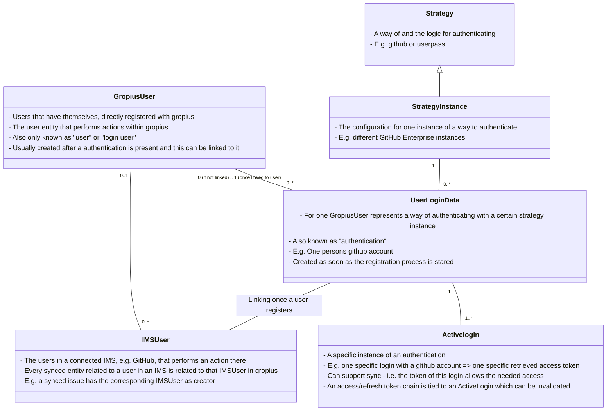

# How-To: Login Service

This How-To walks through the steps to get a Gropius installation going with a fully functional login service: configuring it, logging in the first time, and adding further ways for users to authenticate. It uses the testing docker-compose file, which exposes the debugging ports of every service.

For what the individual concepts mean, see the [Login Service](./login) page.

::: warning
Some steps taken in this How-To are **not** appropriate for a production setup. They are marked where they occur.
:::

## Steps summary

1. Clone the repository
1. Configure the deployment
    1. Set `GROPIUS_ENDPOINT` and the secrets
    1. Have the initial strategy instance and admin user created from the configuration
1. Start the services
1. Log in as the admin user at the Gropius frontend
1. Add the strategy instances you want users to authenticate with
1. Register users, or let them register themselves
1. Add OAuth clients for any application beyond the Gropius frontend

## Cloning

```sh
git clone --recursive https://github.com/ccims/gropius.git
cd gropius
```

## Configuration

The login service, like most Gropius services, is configured through environment variables. They can be set in the environment, in the docker-compose file, or in an env file — for a deployment outside docker, in `gropius-login-service/backend/.env.prod.local` (or `.env.dev.local` when running with `NODE_ENV=development`). Variables set in the environment take precedence over the env files.

For a compose based installation, configure the `login-service` service in the compose file. The examples below refer to `docker-compose-testing.yaml`.

### Endpoint

`GROPIUS_ENDPOINT` is the public URL the whole system is reachable under, `http://localhost:4200` in the testing setup. A surprising amount is derived from it: the redirect URLs of the built-in auth clients, the callback URLs of redirect strategy instances, the allowed CORS origin, and the relying party of passkeys. It has to be the origin users actually reach the deployment on.

::: info
The Gropius frontend, the login service and the login frontend must be served from the same origin. The frontend container reverse-proxies `/auth` to the login service, which is what makes this work in the compose setup.
:::

### Secrets and keys

For production, `./generate_env.sh` writes an `.env` file with generated database passwords, API secrets and the two RSA key pairs the service signs tokens with. The testing compose file has fixed values baked in so that it runs without preparation.

::: warning
The keys and secrets in `docker-compose-testing.yaml` are public. Never expose that setup.
:::

### Access token expiration

`GROPIUS_ACCESS_TOKEN_EXPIRATION_TIME_MS` sets how long issued access tokens stay valid, capped at 10 minutes. Clients are expected to refresh; revoking an already issued access token is not trivial, which is why the cap is low.

### Initial strategy instance and admin user

To get into a fresh system you need a user account, and to create one you need a way of authenticating. The login service can create both on startup.

::: info
It is recommended to set these options only for the initial launch and remove them once the system is set up. They can always be added again if access is lost.
:::

An instance of `userpass` is the most useful starting point, since it needs no external provider:

- `GROPIUS_DEFAULT_STRATEGY_INSTANCE_TYPE` — the strategy to instantiate, `userpass` recommended
- `GROPIUS_DEFAULT_STRATEGY_INSTANCE_CONFIG` — its configuration; `userpass` needs none, so `{}`
- `GROPIUS_DEFAULT_STRATEGY_INSTANCE_NAME` — the name of the instance. It is only created if no instance with that name exists yet.

And the user itself:

- `GROPIUS_DEFAULT_USER_USERNAME` — must be unique; if the user exists, nothing is created
- `GROPIUS_DEFAULT_USER_DISPLAYNAME` — the display name
- `GROPIUS_DEFAULT_USER_STRATEGY_INSTANCE_NAME` — the instance to register the user with, usually the one above
- `GROPIUS_DEFAULT_USER_POST_DATA` — the credentials to register with, in the shape that instance accepts. For `userpass`: `{"password": "PASSWORD_OF_THE_NEW_USER"}`

Setting `GROPIUS_DEFAULT_ENTITIES_ENABLED=false` disables the whole mechanism.

::: info
Users created this way are admins. A user that already exists but is not an admin makes startup fail rather than silently continuing.
:::

::: info
Only one instance can be created from the configuration, and it is claimed by the one the admin user registers with. Any further strategy instance is created through the admin UI or the REST API, as described [below](#adding-strategy-instances).
:::

Auth clients need no configuration: a deployment always has the built-in `gropius-auth-client` and `login-auth-client`, with redirect URLs derived from `GROPIUS_ENDPOINT`.

## Starting up

```sh
docker compose -f docker-compose-testing.yaml up
```

::: warning
This compose file should not be used in production.
:::

This brings up the frontend on `http://localhost:4200`, the public GraphQL API on port 8080, the internal one on 8081 and the login service on port 3000. To verify the login service is running, open its Swagger UI, which documents every endpoint and can execute requests against them:

```
http://localhost:3000/login-api-doc
```

## Logging in for the first time

Open `http://localhost:4200`. The frontend starts an OAuth flow and sends you to the login form at `/auth/flow/login`, showing one tab per strategy instance that accepts credentials and one button per instance that redirects or uses a passkey.

Log in with the username and password configured above. After the consent prompt, the frontend has an access token and you are in.

Users who are allowed to register themselves — instances with _self register_ enabled — use the same form: "Sign up" instead of the login tab, which leads to the registration form and creates the account.

## Managing your own account

`/auth/flow/account` lists every authentication on the account. From here a user can

- change what a strategy allows — the password of a `userpass` authentication, the name of a passkey, the token of a sync authentication,
- remove an authentication, as long as it is not the last one that can log in, and
- **Link Account**: add another authentication, which runs the same login form again and attaches the result to the account instead of creating a user. This is how a user adds a second passkey, connects their GitHub account, or hands Gropius an IMS token for the sync.

## Adding strategy instances

Everything below happens in the Gropius frontend under **Admin → Strategies**, which is available to admin users, and mirrors `/auth/api/login/strategy-instance` in the REST API.

Creating an instance asks for the strategy type, a name, the configuration fields of that strategy, and the four flags. See [strategy instances](./login#strategy-instances) for what each field means and [available strategies](./login#available-strategies) for the configuration each strategy takes.

Recommended flags for a normal login instance: _login_ and _self register_ enabled. For instances that also sync, enable _sync_, and enable _implicit register_ if a user authenticating for the first time should be moved into registration rather than rejected.

### A passkey instance

Create an instance of type `passkey` and leave the configuration empty — relying party id, name, origin and user verification then follow `GROPIUS_ENDPOINT` and the `GROPIUS_PASSKEY_*` variables, which is what a single-domain deployment wants.

::: warning
Passkeys are bound to the relying party id. Setting it explicitly, or moving the deployment to another domain, invalidates the passkeys already registered. Passkeys also require HTTPS, except on `localhost`.
:::

### A GitHub instance

1. [Create a GitHub OAuth app](https://github.com/settings/applications/new). The `Authorization callback URL` has to be the callback URL of the instance you are about to create, which contains its id — so create the app with a placeholder first and correct it in step 4.
1. Create a strategy instance of type `github` with the client id and client secret of the app, and the GraphQL URL of the GitHub instance in `imsTemplatedFieldsFilter` (`https://api.github.com/graphql` for github.com).
1. Read the callback URL off the created instance — the list shows it behind the link icon. It has the form:
   ```
   {GROPIUS_ENDPOINT}/auth/api/internal/auth/callback/{ID_OF_THE_INSTANCE}
   ```
1. Put that URL into the GitHub OAuth app as its `Authorization callback URL`.

A `jira` instance works the same way with an [Atlassian app](https://developer.atlassian.com/console/myapps/).

### A sync-token instance

`github-token`, `jira-token-cloud` and `jira-token-datacenter` take a personal access token rather than running an OAuth flow. They cannot log anyone in — users add them to an existing account through **Link Account** — but they let the sync act as that user. They only need the IMS the token belongs to in `imsTemplatedFieldsFilter`.

## OAuth clients

Any application other than the two built-in ones needs its own auth client, managed under **Admin → OAuth2** or `/auth/api/login/client`. A client has redirect URLs, the scopes it may request, and optionally client secrets.

::: warning
A client without a secret lets anybody who knows its id start a login as that client. Give every client that is not a browser application a secret.
:::

Clients obtain tokens through the authorization code flow with PKCE against `/auth/oauth/authorize` and `/auth/oauth/token`; see [authenticating a client](./login#authenticating-a-client). A refresh token can be exchanged for a new access token at the same token endpoint.

::: warning
Refresh tokens rotate on every use. Presenting one twice is treated as a replay: the access it belongs to is revoked, so the tokens currently in use stop working as well.
:::

## The user concept of the Gropius backend

This section shows the entities and their relations that are useful to know when dealing with users in Gropius.

_Note: the following diagram does not necessarily represent classes and relations in code 1:1. It is a simplification for showing the concepts._



### Linking of IMSUsers and GropiusUsers

_This describes what happens in the background after an authentication is linked to a user and is not needed to use the login service._

Once an authentication that uses a strategy instance representing an IMS — a `github` instance, not a `userpass` one — is linked to a user, the system matches all IMSUsers on that IMS that represent the same person to that authentication, and links them to the GropiusUser.

This lets Gropius relate an action performed in an IMS, and therefore by an IMSUser, to that person's Gropius account. It also works the other way around: when the person acts in Gropius, the system can find the IMSUser and, if one was granted, an access token — so the change synced into the IMS appears under their own name instead of a dummy user.
