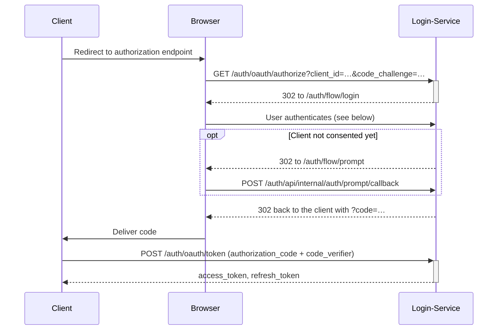
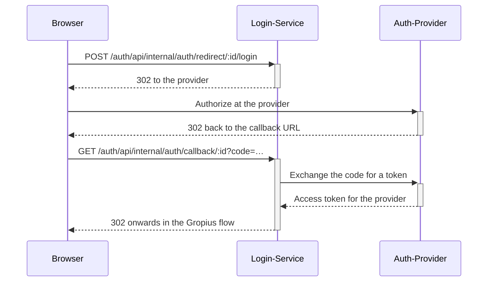
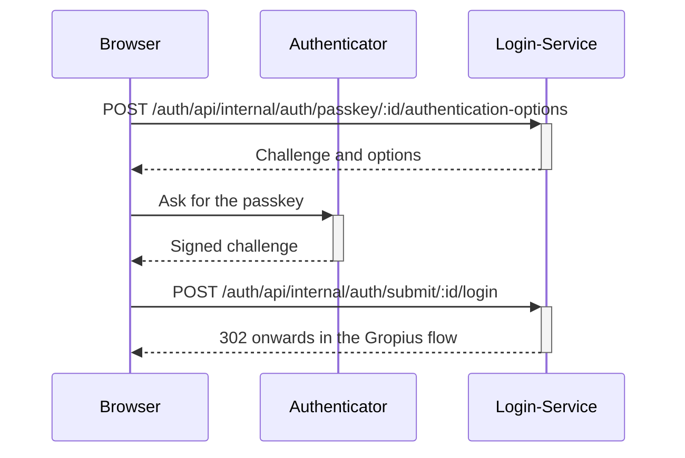
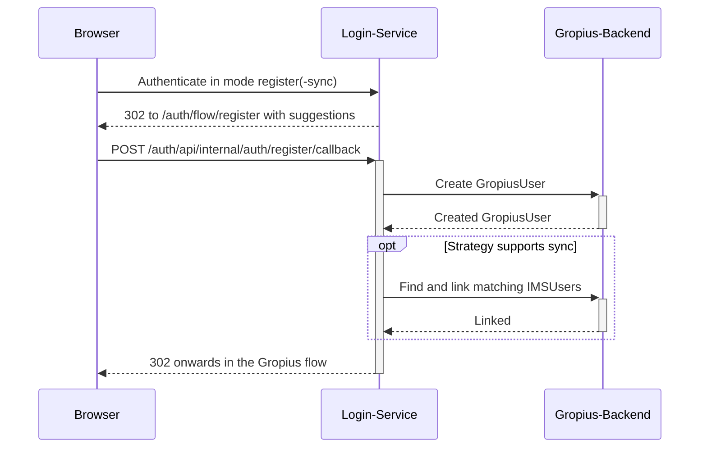

# Login Service

The following page uses [the defined terminology](#terminology).

[NestJS](https://nestjs.com/) service that authenticates users for the Gropius system. It is the OAuth 2.0 authorization server of a Gropius deployment: clients send users here to log in, and it issues the access tokens the backend accepts.

It supports different ways of authenticating, called _strategies_, in order to

- authenticate a user for use of the Gropius backend, and/or
- let the user hand Gropius credentials for an IMS that the sync services use on their behalf.

The service consists of a backend and a small frontend. The frontend is served by the backend under `/auth/flow` and is the UI a user sees while logging in, registering, consenting or managing the authentications on their account. Everything below `/auth` is usually reverse-proxied under the same origin as the Gropius frontend, which the CSRF and cookie handling depend on.

::: info
All authentication interaction follows the OAuth 2.0 specification ([RFC 6749](https://www.rfc-editor.org/rfc/rfc6749)) with PKCE ([RFC 7636](https://www.rfc-editor.org/rfc/rfc7636)). Knowledge of the general principle is assumed below.
:::

## Strategies

One strategy corresponds to one _way_ of authenticating, for example GitHub OAuth or username and password. Strategies are service classes in the login service backend, so adding one is a code change, not a configuration change.

Of each strategy any number of _strategy instances_ can be created at runtime. An instance represents one concrete authentication provider — a specific GitHub Enterprise, a specific Jira Cloud site, or simply "the local username/password login". Its configuration (endpoints, client credentials, …) lives on the instance, so the same strategy can serve several providers of the same kind.

When a user authenticates with an instance, that authentication is stored as _login data_: the association of a Gropius user with a strategy instance, plus whatever the strategy needs to recognise the user next time (a password hash, a GitHub user id, a passkey public key). A single act of logging in against one login data is an _active login_.

### Strategy capabilities

A strategy declares what it is fundamentally able to do. These are properties of the code, and are visible on `GET /auth/api/login/strategy`:

| Capability | Meaning |
| --- | --- |
| `canLoginRegister` | Instances can authenticate users into Gropius. `false` for strategies that only collect IMS credentials for the sync. |
| `canSync` | Instances can supply credentials with which the sync services act as the user in an IMS. See [strategies with sync capability](#strategies-with-sync-capability). |
| `needsRedirectFlow` | Authenticating means sending the user's browser to a third party and receiving them back on the instance's callback URL. |
| `needsPasskeyFlow` | Authenticating is a WebAuthn ceremony: the client fetches a challenge, the authenticator signs it, the result is submitted. |
| `allowsImplicitSignup` | Instances may treat a login by an unknown-but-valid identity as the start of a registration. |
| `forceSuggestedUsername` | The username on the registration form is fixed to what the strategy suggests instead of being freely chosen. |

### Strategy instances

Instances are managed by administrators, either in the Gropius frontend under _Admin → Strategies_ or through `/auth/api/login/strategy-instance`. Each instance has the following fields:

| Field | Meaning |
| --- | --- |
| `name` | Human readable label. Shown as the tab or button caption on the login form and in the user's account overview. Not required to be unique. |
| `type` | The strategy this instantiates. Set on creation and **cannot** be changed afterwards. |
| `instanceConfig` | The strategy-specific configuration, validated by the strategy on create and update. See [available strategies](#available-strategies) for the fields of each. |
| `isLoginActive` | Registered users may log in with this instance. If `false`, existing login data of this instance cannot be used to obtain a token. |
| `isSelfRegisterActive` | Users may create their own account from an authentication with this instance. Administrators can register users either way. |
| `isSyncActive` | The sync services may retrieve IMS access tokens obtained through this instance. |
| `doesImplicitRegister` | A user who authenticates successfully but matches no account is moved into registration instead of being rejected. |
| `callbackUrl` | Read-only and derived from the instance id: the redirect URI to register with the third-party provider. Only meaningful when the strategy needs a redirect flow. |

::: info
Each of the four flags is capped by the corresponding strategy capability — `isLoginActive` needs `canLoginRegister`, `isSyncActive` needs `canSync`, `doesImplicitRegister` needs `allowsImplicitSignup`. Enabling something the strategy cannot do leaves the flag off rather than failing. When an instance is created without stating a flag, it defaults to what the strategy supports.
:::

Deleting an instance removes the way its users authenticate, so a user whose only login data belongs to it loses access to their account.

### Strategies with sync capability

A strategy has the sync capability if an instance of it can provide credentials with which the sync services impersonate the user in an IMS.

Such a strategy corresponds to a specific IMSTemplate in the Gropius backend, as it references a type of IMS. One strategy instance represents any number of IMSs of that template that point at the same real issue management system — even if several IMS objects for one GitHub Enterprise exist in the backend, only one strategy instance should exist for it. One login data then maps to all IMSUser objects representing that user in those IMSs.

On top of the general strategy behaviour, a syncing strategy

- provides the credentials for the sync given a login data,
- states the templated field values an IMS must match to be considered the same system as the strategy instance,
- states the templated field values an IMSUser must match to belong to a given login data, and
- states the login data contents that make it a match for a given IMSUser (the opposite direction).

The first three are configured through `imsTemplatedFieldsFilter` in the instance config, which is why every syncing strategy requires it.

The sync services fetch these credentials from `GET /auth/api/sync/get-ims-token/{imsUserId}`, authenticated with the shared secret in `GROPIUS_LOGIN_SYNC_API_SECRET`.

### Available strategies

| Strategy | Login | Sync | Flow | Implicit signup |
| --- | --- | --- | --- | --- |
| [`userpass`](#userpass) | yes | no | credentials | no |
| [`passkey`](#passkey) | yes | no | passkey | no |
| [`github`](#github) | yes | yes | redirect | yes |
| [`jira`](#jira) | yes | yes | redirect | yes |
| [`github-token`](#github-token) | no | yes | credentials | no |
| [`jira-token-cloud`](#jira-token-cloud) | no | yes | credentials | no |
| [`jira-token-datacenter`](#jira-token-datacenter) | no | yes | credentials | no |

#### `userpass`

Username and password, stored as a bcrypt hash in the login data. The user submits `username` and `password`.

- Instance config: none, `{}`
- Update actions: `update-password`
- The username chosen at registration is fixed to the one used to authenticate

#### `passkey`

Passkeys ([WebAuthn](https://www.w3.org/TR/webauthn-2/)) as a replacement for a password rather than as a second factor. Credentials are created as discoverable credentials, so logging in needs no username: the authenticator returns which credential was used and the account is found by its credential id. Only the public key, the credential id and the signature counter are stored; the counter is checked on every login so that a cloned authenticator is detected.

Instance config — all fields are optional and inherit the deployment configuration when unset, which is what an instance created without config does:

| Field | Meaning |
| --- | --- |
| `rpId` | The domain credentials are scoped to, without scheme or port. Defaults to `GROPIUS_PASSKEY_RP_ID`, in turn the host of `GROPIUS_ENDPOINT`. |
| `rpName` | The name the authenticator displays. Defaults to `GROPIUS_PASSKEY_RP_NAME`. |
| `origin` | Comma-separated origins a ceremony may run on. Defaults to `GROPIUS_PASSKEY_ORIGIN`, in turn the origin of `GROPIUS_ENDPOINT`. |
| `userVerification` | `required`, `preferred` or `discouraged`. Defaults to `GROPIUS_PASSKEY_USER_VERIFICATION`, which itself defaults to `required` because a passkey is the only factor. |

Update actions: `rename`, to label a passkey in the account overview.

::: warning
Changing `rpId` invalidates every passkey already registered on the instance — the credentials are bound to it. The same applies to moving a deployment to a different domain without setting `rpId` explicitly.
:::

::: info
WebAuthn only works in a secure context, so the deployment has to be served over HTTPS. `localhost` counts as secure, which is what makes local development work.
:::

#### `github`

GitHub OAuth, both for logging in and for obtaining a token the sync can use. Requires a [GitHub OAuth app](https://github.com/settings/applications/new) whose authorization callback URL is the instance's `callbackUrl`.

| Field | Meaning |
| --- | --- |
| `imsTemplatedFieldsFilter.graphql-url` | GraphQL endpoint identifying the GitHub instance. Defaults to `https://api.github.com/graphql`. |
| `authorizationUrl` | Defaults to `https://github.com/login/oauth/authorize`. |
| `tokenUrl` | Defaults to `https://github.com/login/oauth/access_token`. |
| `userProfileUrl` | API URL the profile is read from. Needed for GitHub Enterprise. |
| `clientId`, `clientSecret` | Credentials of the OAuth app. Default to `GROPIUS_OAUTH_CLIENT_ID` / `GROPIUS_OAUTH_CLIENT_SECRET`. |

#### `jira`

Atlassian OAuth for Jira Cloud, for logging in and for sync. Requires an [Atlassian app](https://developer.atlassian.com/console/myapps/).

| Field | Meaning |
| --- | --- |
| `imsTemplatedFieldsFilter.root-url` | Root URL of the Jira site. Required. |
| `authorizationUrl` | Defaults to `https://auth.atlassian.com/authorize`. |
| `tokenUrl` | Defaults to `https://auth.atlassian.com/oauth/token`. |
| `cloudIdUrl` | Where the cloud id of the site is resolved. Defaults to `https://api.atlassian.com/oauth/token/accessible-resources`. |
| `userProfileUrl` | API URL the profile is read from. |
| `clientId`, `clientSecret` | Credentials of the Atlassian app. Default to `GROPIUS_OAUTH_CLIENT_ID` / `GROPIUS_OAUTH_CLIENT_SECRET`. |

#### `github-token`

Sync-only. The user pastes a GitHub personal access token, which is stored encrypted and handed to the sync. It cannot be used to log in, so it is always added to an existing account.

- Submitted variables: `token`
- Instance config: `imsTemplatedFieldsFilter.graphql-url`, defaulting to `https://api.github.com/graphql`
- Update actions: `update-token`

#### `jira-token-cloud`

Sync-only. Email address plus an [Atlassian API token](https://id.atlassian.com/manage-profile/security/api-tokens) for a Jira Cloud site.

- Submitted variables: `email`, `token`
- Instance config: `imsTemplatedFieldsFilter.root-url`, required
- Update actions: `update-token`

#### `jira-token-datacenter`

Sync-only. A personal access token of a Jira Data Center installation.

- Submitted variables: `token`
- Instance config: `imsTemplatedFieldsFilter.root-url`, required
- Update actions: `update-token`

## Authenticating a client

A client — the Gropius frontend, the login frontend itself, or any other application — obtains tokens through the OAuth 2.0 authorization code flow with PKCE.

- Authorization endpoint: `GET /auth/oauth/authorize`
- Token endpoint: `POST /auth/oauth/token`

The token endpoint supports the grant types `authorization_code`, `refresh_token` and `client_credentials`. `code_challenge_method=S256` is required on the authorization request.

Tokens are issued with one or more scopes:

| Scope | Grants |
| --- | --- |
| `backend` | Access to the Gropius backend GraphQL API. |
| `login` | Access to the login service API, e.g. to manage one's own authentications. |
| `login-register` | Only completing a registration. Issued while a registration is in progress and cannot be requested by a client. |
| `auth` | Used for the login service's own frontend session handling. |

A deployment always has two built-in auth clients, both internal and requiring no secret: `gropius-auth-client` for the Gropius frontend and `login-auth-client` for the login frontend. Further clients, with secrets and redirect URLs, are managed under `/auth/api/login/client` or in the Gropius frontend under _Admin → OAuth2_.

## Authenticating a user

Inside that flow the user authenticates against one strategy instance. Which of the three shapes is used follows from the strategy's capabilities, and the login frontend picks it automatically. All three end in the same place: an active login is created and the OAuth flow continues.

Every mode below can be run as one of three _modes_:

1. `login` — authenticate as an existing user
2. `register` — authenticate in order to create a new account or add an authentication to an existing one
3. `register-sync` — same, but also ask the provider for the permissions the sync needs

::: info
The endpoints under `/auth/api/internal` are driven by the login frontend, not by clients. They are session based and require the session-bound CSRF token (`GET /auth/api/internal/auth/csrf`) and, for anything belonging to a running flow, the flow-bound token (`GET /auth/api/internal/auth/flow`).
:::

### Submitting credentials

Used by strategies that need neither a redirect nor a passkey, such as `userpass` and the token strategies. The credentials named by the strategy's `acceptsVariables` are posted to

`POST /auth/api/internal/auth/submit/{instanceId}/{mode}`

### Redirect

Used by strategies with `needsRedirectFlow`, such as `github` and `jira`. The browser is sent to the third-party authorization server and returns to the instance's callback URL.

- `POST /auth/api/internal/auth/redirect/{instanceId}/{mode}` starts it
- `GET /auth/api/internal/auth/callback/{instanceId}` receives the user back

### Passkey

Used by strategies with `needsPasskeyFlow`. A passkey cannot be submitted in one request: the client first asks for a challenge, lets the authenticator sign it, and submits the result to the same submit endpoint as any other credential.

- `POST /auth/api/internal/auth/passkey/{instanceId}/registration-options` for a new passkey
- `POST /auth/api/internal/auth/passkey/{instanceId}/authentication-options` for an existing one
- `POST /auth/api/internal/auth/submit/{instanceId}/{mode}` with the signed result

The challenge is stored on the session, bound to session, flow and strategy instance, and is removed as soon as it is answered, so it can be used exactly once.

## Registration

A user authenticating in the `register` or `register-sync` mode — or in `login` against an instance with `doesImplicitRegister` — produces login data in the state `WAITING_FOR_REGISTER`. It is not yet usable for logging in; it has to be attached to a Gropius user first. The login service redirects the browser to `/auth/flow/register` with the data the strategy could suggest for the new account, prefilling the form.

Completing the form posts to `POST /auth/api/internal/auth/register/callback`, which creates the GropiusUser in the backend, attaches the login data to it, and continues the OAuth flow so that the client ends up with a normal access token.

Whether a user may do this themselves is governed by `isSelfRegisterActive` on the instance.

### Linking further authentications

A logged-in user can add another way of authenticating — a second passkey, a GitHub account, an IMS token for the sync — from `/auth/flow/account`. This starts a link flow with `POST /auth/api/internal/auth/flow/start-link`, runs one of the authentication shapes above, and attaches the resulting login data to the account already signed in instead of creating a user.

An authentication that is already linked to a user cannot be moved to another one.

### Managing authentications

`/auth/flow/account` lists the authentications on the account, each with the description its strategy provides. From there a user can

- run a strategy's update actions, e.g. change a `userpass` password or rename a passkey, with `PUT /auth/api/internal/update-action/{loginDataId}/{action}`, and
- remove an authentication with `POST /auth/api/internal/update-action/{loginDataId}/delete`. The last login-capable authentication of a user cannot be removed.

### Linking IMSUsers and GropiusUsers

After a login data of a syncing strategy instance is linked to a user, the service matches all IMSUsers on the corresponding IMSs that represent the same person and links them to the GropiusUser. This lets Gropius relate actions performed in an IMS to a Gropius account, and in the other direction lets it find the IMSUser — and a token — when the person acts in Gropius, so that a synced change appears under their name rather than a dummy user.

## Sessions and logout

The browser session is a signed cookie named `gropius-login-session`, scoped to the `/auth` path. It holds the session id, the CSRF token, the authenticated user, the consents already given and the state of the flow in progress. It carries no secrets.

- `POST /auth/api/internal/auth/logout/current` ends the current session
- `POST /auth/api/internal/auth/logout/everywhere` additionally revokes all tokens issued for the user

Since a user never "logs into" a client but only authorises it, clients are expected to drop their tokens on logout and not silently start a new authorization flow afterwards.

## Expirations

| Record | Expiration |
| --- | --- |
| Access token | `GROPIUS_ACCESS_TOKEN_EXPIRATION_TIME_MS`, at most 10 minutes |
| Refresh token | `GROPIUS_REFRESH_TOKEN_EXPIRATION_TIME_MS`, 2 hours by default |
| Authorization code | `GROPIUS_AUTHORIZATION_CODE_EXPIRATION_TIME_MS`, 10 minutes by default |
| Flow | `GROPIUS_FLOW_EXPIRATION_TIME_MS`, 10 minutes by default |
| Active login | `GROPIUS_ACTIVE_LOGIN_EXPIRATION_TIME_MS`, extended on use, capped by `GROPIUS_ACTIVE_LOGIN_MAX_EXPIRATION_TIME_MS` |
| Session cookie | Follows the flow while unauthenticated, the active login once authenticated |

A record is only valid while neither it nor its parent has expired.

## Terminology

- **Authentication** — the proof of identity of a user
- **(3rd party) authentication provider** — a service that proves a user's identity to another service
- **Strategy** — one way of authenticating, implemented in code
- **Strategy instance** — one configured provider of a strategy
- **Login data** — one user's authentication with one strategy instance, also called an authentication
- **Active login** — a single act of logging in with a login data
- **Auth client** — an application that sends users here to authenticate
- **Registration** — the first time a user authenticates intending to create an account or add an authentication to an existing one
- **Login** — authenticating with the intent to access Gropius with an existing account
